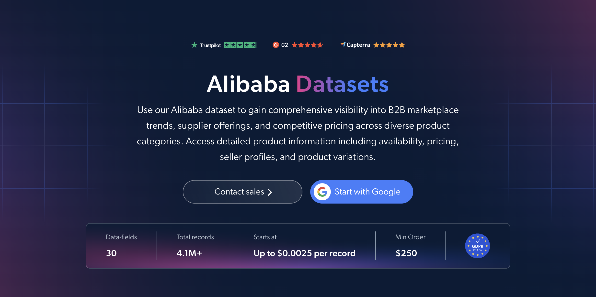

# Alibaba 数据集样本
<h2>包含 1000 个阿里巴巴产品的示例数据集</h2>

<a href="https://www.bright.cn/products/datasets/alibaba">
   
</a>

包含 1000 个产品的阿里巴巴数据集示例。该数据集使用 <b>Bright Data API</b> 提取。

<h2>数据集中包含的部分数据点：</h2>

* ```url```：阿里巴巴产品页面的 URL
* ```item_id```：每个产品的唯一标识符
* ```variant_id```：每个产品变体的唯一标识符
* ```title```：产品标题
* ```description```：产品的完整描述
* ```product_category```：产品类别
* ```category_tree```：产品类别路径，包含名称和 URL
* ```brand```：产品品牌
* ```image_url```：产品主图的 URL
* ```price```：产品原价
* ```sale_price```：产品折扣价
* ```availability```：库存状态，例如有货、缺货或预售
* ```variants```：所有可用的变体选项，按类型分组
* ```variant_attributes```：所选变体的属性，例如颜色或尺寸
* ```store_name```：供应商店铺名称
* ```seller_url```：供应商店铺页面的 URL
* ```store_country```：供应商店铺所在国家/地区
* ```return_window```：允许退货的天数
* ```star_rating```：0-5 分制的平均评分
* ```review_count```：产品评论数量
* ```reviews```：产品的客户评论

以及更多数据。

这是“阿里巴巴产品（公开数据）”数据集的示例子集，该完整数据集包含超过 <b>4,100,000 个产品</b>。

可用的数据集文件格式：<b>JSON、NDJSON、JSON Lines、CSV、XLSX 或 Parquet。还可选择将文件压缩为 .gz 格式</b>。

数据集交付方式选项：<b>电子邮件、API 下载、Webhook、Amazon S3、Google Cloud Storage、Google Cloud PubSub、Microsoft Azure、Snowflake、SFTP</b>。

更新频率：<b>单次、每日、每周、每月、每季度、每半年或自定义</b>。

可在提取的数据点基础上额外提供数据增强：<b>根据需求提供。</b>

<b>[获取完整的阿里巴巴数据集](https://www.bright.cn/products/datasets/alibaba)</b>。

<a href="https://www.bright.cn/products/datasets/alibaba">
</a>

<h2>阿里巴巴数据集有哪些使用场景？</h2>

<h3>1. 批发价格基准比较</h3>
企业使用阿里巴巴数据集比较不同类别中同类产品的供应商价格。通过对原价和促销价进行基准比较，采购团队可以估算合理的批发成本，并与制造商协商更有利的条款。

<h3>2. 筛选供应商候选名单</h3>
零售商和采购团队根据产品线及店铺所在国家/地区，筛选制造商和出口商候选名单。通过每个供应商的店铺页面链接，可以在联系前轻松跟进并比较其产品。

<h3>3. 买家对供应商的反馈</h3>
企业结合退货条款查看星级评分和评论，了解买家对产品质量及供应商可靠性的评价。这有助于降低采购风险，并在下单前识别值得信赖的供应商。

<h2>为学术研究人员和非政府组织免费提供网页爬虫工具及数据集</h2>

Bright Initiative 为顶尖高校院系和研究人员，以及致力于推动各类环境与社会事业的非政府组织和非营利组织，提供 Bright Data 的 <b>[爬虫工具 API](https://www.bright.cn/products/web-scraper)</b> 和 <b>[即用型数据集](https://www.bright.cn/products/datasets)</b>。你可以在<b>[此处](https://brightinitiative.com)</b>提交申请。
